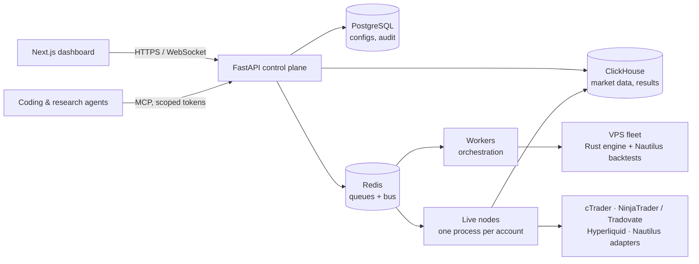

# Anquant

**An algorithmic trading platform for research, backtesting and live execution, built and run by one engineer.**

Anquant takes a strategy from idea to live trading in one system: data ingest, large-scale parameter screening,
full-fidelity backtests, robustness testing, portfolio construction and live execution on real broker and prop-firm
accounts, all managed from one web dashboard.

> The codebase is private. This repository describes what the system does and how it is built.
> It contains no strategy logic, parameters or trading results.

**Status:** in continuous development since 2023, trading live on my own capital.
**Author:** [Antoni Kois](https://www.linkedin.com/in/anteqkois/)

---

## Screenshots

| | |
|---|---|
|  |  |
| *Backtest results and leaderboard* | *Backtest–live parity report* |
|  |  |
| *Live deployments* | *Distributed backtest fleet* |

---

## Architecture

## Highlights

### Two engines, one result
- A **Rust engine** screens millions of parameter combinations in distributed runs across a self-provisioned VPS fleet.
- **Nautilus Trader** runs the full-fidelity backtest and the live execution of the strategies that survive screening.
- The backtest must reproduce live trading **bar for bar**. Parity between the two engines and between backtest and
  live is enforced by tests and monitored in production; a parity break is a recorded incident, not a footnote.

### Broker-agnostic execution
- Native adapters for **cTrader**, **NinjaTrader / Tradovate** and **Hyperliquid**, plus the **Nautilus Trader**
  integration set. Any broker or prop firm reachable through those platforms can be connected.
- Traded on **FTMO, IC Markets, Hyperliquid, Polymarket and Binance**.
- Providers, brokers and adapters are grouped by the external system they integrate, so adding a venue is a bounded task.

### Prop-firm accounts as a first-class problem
- A **Rust account simulator** encodes each firm's rules (drawdown limits, payout rules, futures-specific rules) as
  modules. The same simulator runs in the optimiser, in the backtest and in the live account guard.
- A **genetic optimiser** searches account-management policies across fleets of prop accounts, with selectable
  objectives (payout across the challenge chain, purchase value by backward induction, days to first payout). Its state is checkpointed so a run resumes
  bit for bit.

### Live trading built to fail safely
- **One OS process per venue × account**: a crash on one account never touches another.
- An **account guard** with quarantine, an orphan-position custodian and a fuse, configured from the account's firm
  rules rather than hard-coded limits.
- Failover to fallback nodes with a deep broker health probe before a node may reclaim its positions.
- Broker reconciliation: the broker's balance is compared with the platform's own reconstruction at every checkpoint.
- Strategy upgrades are hot-swapped on a running deployment from versioned, published packages.

### Research discipline
- Robustness tests (Monte Carlo permutation, parameter stability, noise perturbation) run on every completed backtest;
  an out-of-sample verdict that cannot be judged blocks a strategy from going live.
- A **sealed out-of-sample hold-out**: results stay hidden until an explicit, recorded reveal, so the hold-out cannot
  leak into decisions.
- Every run metric is computed from stored orders, positions and bars in one shared results writer, never inside an engine.

### Infrastructure
- Self-provisioned Linux and Windows worker fleet (Windows nodes host NinjaTrader) with **signed provisioning updates**.
- Strategy code ships to workers as versioned wheels; each run freezes an exact version.
- Market data in ClickHouse with a coverage ledger and automated data-quality checks.
- An **MCP server** generated from the OpenAPI spec exposes the platform to agents, with per-token access scopes.

## How it is built

Anquant is developed **agent-first**: I own the architecture, the specifications and the review, and coding agents
(mainly Claude Code) implement behind test and CI gates.

- Every significant decision is recorded as an ADR before or with the code that implements it (600+ so far).
- The repository carries its own agent instructions (`AGENTS.md`) and 28 task-specific skills, so agents follow the
  same conventions I do: how to change the schema, how to run tests, which traps each broker adapter has.
- The full test battery runs in CI; agents commit through a clean-worktree script so parallel sessions never
  overwrite each other's work.
- Earlier versions were written by hand. Agents did not change what the system is meant to do; they changed how
  much one person can build and maintain.

## Tech stack

**Backend:** Python (uv workspace), FastAPI, Pydantic v2, Nautilus Trader, Rust (engine, account simulator,
optimiser, cTrader client), Dramatiq · **Frontend:** Next.js, React, TypeScript, shadcn/ui ·
**Data:** PostgreSQL (Alembic), ClickHouse, Redis, Parquet · **Infra:** Docker, VPS fleet (Linux + Windows),
GitHub Actions, Vector · **Testing:** pytest, Vitest, Playwright

## Contact

Antoni Kois · [LinkedIn](https://www.linkedin.com/in/anteqkois/) · [GitHub](https://github.com/anteqkois) · [X](https://x.com/anteqkois)
